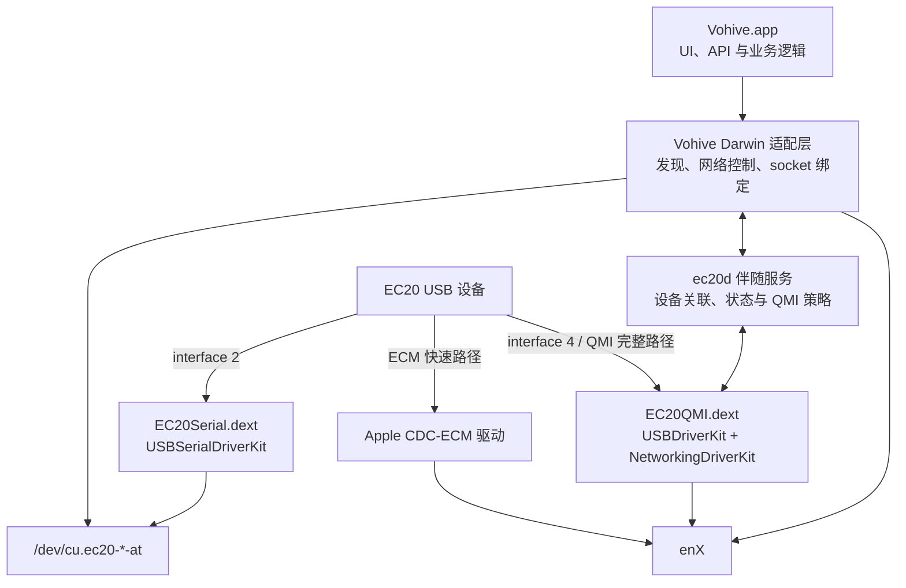

# EC20 macOS 应用与 Vohive 兼容架构

## 1. 文档目的

本文定义 EC20 macOS 项目的目标架构、组件职责、权限边界和演进路线。最终目标不是在 macOS
上仿造 Linux 的 `ttyUSB*`、`cdc-wdm*`、sysfs 或 udev，而是：

1. 向 macOS 提供标准串口和网络接口；
2. 为 Vohive 增加原生 Darwin 平台实现；
3. 在快速可验证的 ECM 路径之外，保留完整 QMI 功能路径；
4. 最终把驱动、伴随服务和 Vohive Darwin 版封装为可安装、可升级、可恢复的 macOS 应用。

本文中的“完整功能”是一个验收目标，不等于第一版 MVP。只有 Vohive 的功能矩阵在 macOS
上逐项通过，才能宣称达到完整功能兼容；仅能收发 AT 或仅能通过 ECM 上网都不属于完整功能版。

## 2. 已验证的硬件基线

当前实机基线为：

- USB VID/PID：`2c7c:0125`；
- 型号：Quectel EC20F；
- 固件：`EC20CEFDGR06A08M4G`；
- configuration 1、interface 2 是厂商自定义 AT 通道；
- interface 2 的 endpoint 为 `0x03` bulk OUT、`0x84` bulk IN、`0x85` interrupt IN；
- interface 4 保留给网络数据面，不能注册成串口；
- `AT+QCFG="usbnet"` 当前返回 `0`；
- 普通用户态程序已通过 `IOUSBHost.framework` 完成 interface 2 的 AT 收发。

这些信息是当前固件 profile 的匹配条件，不应被提升为所有 EC20/EC25 固件永远不变的假设。
正式实现仍须校验 USB 描述符、endpoint 方向和数量；不匹配时应拒绝绑定，而不是猜测端点。

## 3. 总体分层



ECM 和自研 QMI 网络驱动是同一设备数据面的两条互斥路径：

- **ECM 快速路径**利用 Apple 自带驱动，降低早期风险，优先验证 Vohive 的 AT 管理、代理和
  多设备网络出口；
- **QMI 完整路径**由项目自己的 DriverKit 网络扩展和伴随服务实现，用于补齐 WDS、DMS、
  NAS、UIM、WMS、Raw-IP 等 Vohive QMI 功能。

任何时刻，同一个 USB interface 只能有一个 owner。`ec20d`、实验探针和 DriverKit 扩展不得
同时打开同一个 interface。

## 4. 阶段一：普通用户态 `ec20d` 实验层（MVP）

### 4.1 目标

MVP 在不依赖 DriverKit entitlement 和系统扩展安装的前提下，尽快验证上层架构。它把已经
验证的 AT 探针演进为普通用户态服务 `ec20d`：

- 通过 `IOUSBHost.framework` 独占打开已验证的 interface 2；
- 处理 bulk IN/OUT、命令超时、响应终止行和异步 URC；
- 通过带版本号的本地 Unix socket 向 Vohive Darwin 适配层提供请求/事件；
- 可选创建 PTY 兼容桥，用于验证 Vohive 现有串口库；
- 监测拔插和重新枚举，释放所有 USB 资源并通知客户端；
- 记录 USB 拓扑身份，但不把运行期端口名当作永久身份。

PTY 只是实验兼容层，不能作为正式驱动接口。它可能出现名称变化、权限和串口控制语义不完整等
问题。产品版应由 `USBSerialDriverKit` 提供真正的 `/dev/cu.*` 节点。

### 4.2 MVP 明确包含

- 单台 EC20 的 AT、IMEI、固件、SIM 状态和信号查询；
- AT 命令串行化以及 URC 与命令响应分流；
- 安全的、需要显式确认的 ECM 模式切换实验；
- Apple ECM 成功后对 `enX`、地址、DNS 和公网出口的验证；
- Vohive Darwin 最小构建、设备发现和 AT backend 接通；
- macOS socket 按接口绑定的验证；
- 状态变化和错误的结构化日志，不记录 SIM PIN、APN 密码或短信正文。

### 4.3 MVP 明确不包含

- 可分发的标准 `/dev/cu.ec20-*` 串口驱动；
- 自研 QMI 网卡、Raw-IP 数据面或 `/dev/cdc-wdm*` 仿真；
- Vohive 全部 QMI/MBIM/VoWiFi 功能；
- 无人值守的 USB 模式切换和自动固件恢复；
- 完整多设备并发和面向最终用户的驱动安装体验。

MVP 的完成标准是证明“EC20 AT + Apple ECM + Vohive Darwin 网络出口”这条端到端链路成立，
而不是宣称已完成驱动或实现 Vohive 完整功能。

## 5. 阶段二：`USBSerialDriverKit` 生产串口层

`EC20Serial.dext` 是正式产品的串口数据面，取代 `ec20d` 直接打开 USB interface 2 的做法。
它应保持职责最小化：

- 只匹配明确支持的 VID/PID、configuration、interface 和 endpoint profile；
- 第一版只注册 interface 2 为 AT 口；
- 向系统发布稳定、可识别的 `/dev/cu.ec20-<topology>-at`；
- 正确实现串口 open/close、读写、取消、拔出和休眠唤醒语义；
- 向 IORegistry 发布 vendor、product、interface role、USB registry identity 等关联属性；
- 永远不把 interface 4 注册成串口；
- 不解析短信、APN、QMI，也不承载 Vohive 业务逻辑。

生产版的 Vohive 继续使用标准串口 API，不应依赖 DriverKit 私有调用。这样既能兼容 Vohive，
也允许其他终端工具打开 AT 口。串口并发仍须由上层仲裁：默认由 Vohive/`ec20d` 中一个进程
独占打开，其他客户端收到清晰的 busy 错误。

DriverKit 扩展必须包含在签名的宿主应用内，并取得 Apple 对应的 USB/Serial entitlement。扩展
激活、升级和卸载都要遵循系统扩展流程，应用不能绕过用户批准或降低系统安全设置。

## 6. Apple ECM 快速路径

在固件确认支持并准备恢复通道后，可把模块切换到 ECM profile，让标准 CDC-ECM 描述符由
macOS 自带驱动接管，并产生 `enX`。这条路径的原则是：

- Apple 驱动负责 USB 网络数据面；
- macOS 网络栈负责地址、DHCP、IPv6 和链路状态；
- Vohive Darwin 的 ECM controller 负责 APN/会话策略、等待地址、连通性检测和断开；
- 代理和探测 socket 显式绑定到对应 `enX`，不得静默回退到 Wi-Fi；
- 不随意修改系统全局默认路由或全局 DNS；多卡流量必须保持接口隔离。

ECM 产品版可提供 Vohive 的大部分 AT 管理、短信、USSD、eSIM/AT、HTTP/SOCKS5 代理和设备池
能力，但不能自然提供所有 QMI 事件和服务。因此它是优先交付路径，仍不是“完整 QMI 功能版”。

如果目标固件不能枚举标准 ECM，或其 ECM 会话无法满足多卡、重拨和状态事件要求，应停止在
ECM 层堆积固件特例，转入完整 QMI 路径。

## 7. 阶段三：完整 QMI DriverKit 与 companion 路径（最终目标）

### 7.1 QMI 驱动职责

`EC20QMI.dext` 接管网络 interface 4，使用 `USBDriverKit` 完成 USB transport，并使用
`NetworkingDriverKit` 向 macOS 发布网络接口。最终实现至少包括：

- QMUX/QMI 帧收发、事务 ID、client ID 和并发请求关联；
- WDS 数据会话建立、停止和地址配置；
- DMS 设备身份与运行状态；
- NAS 注册、制式、信号和小区状态；
- UIM/SIM 状态及 Vohive 所需的相关操作；
- WMS 消息能力，或与 AT 消息 backend 的明确能力选择；
- Raw-IP 与 NetworkingDriverKit 所呈现链路帧之间的封装/剥离；
- MTU、校验、背压、取消、重连、休眠唤醒和异常帧限制。

在正式冻结实现前，必须先用最小原型验证所需 DriverKit entitlement、USB 与网络 provider 的
组合方式，以及 DriverKit 用户客户端通信机制。架构不应假设未经实机验证的 entitlement 一定
会被 Apple 批准。

### 7.2 companion 服务职责

最终 `ec20d` 不再直接抢占已由 dext 所有的 USB interface，而是作为受控伴随服务：

- 维护物理设备、AT 口、QMI transport 和 `enX` 的关联；
- 承载 APN、拨号、重连、能力协商等策略；
- 通过有版本的受控接口与 DriverKit 扩展通信；
- 向 Vohive 暴露稳定、平台无关的 QMI transport/事件 API；
- 对固件差异做显式 profile 管理，不把固件特例放入 Vohive UI；
- 维护会话 journal，崩溃或升级后能够识别并清理遗留连接。

DriverKit 层只保留安全且延迟敏感的传输和数据面逻辑；复杂业务策略留在可独立测试、可快速更新
的 companion 服务中。不得为了兼容 Linux 而伪造 `/dev/cdc-wdm*`、sysfs 或 udev。

### 7.3 “完整功能”验收边界

最终版本至少要逐项覆盖并自动化验证：

- 设备发现、热插拔、休眠唤醒和多设备并发；
- AT 终端、设备信息、SIM、信号、短信、USSD、eSIM/APDU；
- QMI WDS/DMS/NAS/UIM/WMS 中 Vohive 实际使用的全部操作与事件；
- 数据连接、断开、重拨/换 IP、IPv4/IPv6、DNS 和接口绑定；
- 每个 EC20 独立的 HTTP/SOCKS5 代理和网络探测；
- 应用、daemon、dext 的安装、升级、回滚和卸载。

Vohive 的 VoWiFi/IPsec 依赖目前包含 Linux 专用行为。它必须有独立的 macOS 可行性门禁：只有
Apple 公共 API、所需 entitlement 和目标运营商认证都验证通过，才能把 VoWiFi 标记为支持。
如果这一门禁未通过，产品必须在能力矩阵和 UI 中明确标记不可用，不能把“AT + QMI 已完成”
描述成 Vohive 全功能兼容。

## 8. Vohive Darwin 适配层

Vohive 应保留现有业务模型，在平台边界处增加接口和 build tags，而不是复制整套业务代码。
推荐形成以下平台抽象：

```go
type DeviceProvider interface {
    Discover(ctx context.Context) ([]Device, error)
    Watch(ctx context.Context, emit func(DeviceEvent)) error
}

type NetworkController interface {
    Connect(ctx context.Context) error
    Disconnect(ctx context.Context) error
    IsConnected(ctx context.Context) (bool, error)
    RotateIP(ctx context.Context) error
}

type InterfaceBinder interface {
    Bind(fd uintptr, network, interfaceName string) error
}
```

Darwin 实现包括：

- 使用 IOKit/IORegistry 或 `ec20d` API 发现设备并监听服务变化；
- 通过共享 USB registry ancestry 把 AT 口和 `enX` 关联到同一台 modem；
- ECM controller 和 QMI controller 按能力动态选择；
- IPv4 使用按接口绑定，IPv6 使用对应的按接口绑定选项；
- DNS 查询同样按 modem 出口隔离；
- Linux-only 的 sysfs、netlink、`SO_BINDTODEVICE`、QMI netcfg 和 VoWiFi 代码以 build tags 隔离；
- 功能缺失返回明确的 `unsupported` 能力，不允许无声降级。

Vohive 上层通过 capability 集合决定是否显示 QMI、短信、eSIM、VoWiFi、换 IP 等操作。功能
选择不能仅依赖 `mode == qmi` 或 `mode == ecm` 这种单一字符串。

## 9. 设备身份与多设备关联

`enX`、`/dev/cu.*` 和 USB registry entry 都可能在拔插、重启、模式切换后变化，不能作为永久
设备 ID。建议维护三层身份：

1. **本次枚举身份**：IORegistry entry ID、USB location ID、registry path 和 generation；
2. **物理拓扑身份**：Mac USB 端口/Hub 路径，用于模块尚未响应 AT 时的临时关联；
3. **逻辑 modem 身份**：成功读取后的 IMEI（必要时结合模块序列号），用于 Vohive 持久配置。

设备状态记录示例：

```json
{
  "schema": 1,
  "device_id": "modem:<stable-id>",
  "generation": 7,
  "usb": {
    "location_id": "03120000",
    "vendor_id": 11388,
    "product_id": 293
  },
  "at_port": "/dev/cu.ec20-03120000-at",
  "network_interface": "en7",
  "mode": "ecm",
  "capabilities": ["at", "sms", "ecm"]
}
```

关联规则如下：

- 枚举期间先按共同 USB parent/拓扑把 interface、串口和网卡归组；
- AT 可用后读取 IMEI，将临时组提升为稳定 modem；
- 模式切换导致重新枚举时递增 generation，旧句柄和旧事件一律失效；
- `enX` 只作为当前 generation 的属性，不能写死进长期配置；
- IMEI 缺失或重复时进入隔离状态，要求用户确认，不得把两台设备合并；
- 用户别名绑定稳定 modem ID，而不是端口名；
- 多设备请求始终携带 `device_id + generation`，防止拔插后命令误发给另一台 modem。

## 10. 信任与权限边界

### 10.1 最小权限原则

- `Vohive.app`/UI 不直接访问原始 USB，不以 root 运行；
- `EC20Serial.dext` 只拥有串口 interface；
- `EC20QMI.dext` 只拥有获准的网络 interface 和网络 provider 权限；
- `ec20d` 只执行设备关联和受控 modem 操作；需要特权的系统网络配置应进一步收敛到最小
  helper，而不是让整个 Vohive 以 root 运行；
- 组件间协议必须有 schema/version、消息长度上限、超时和严格字段校验；
- IPC 端验证客户端签名身份/audit token，不向任意本地进程开放原始 QMI 或危险 AT 写入；
- SIM PIN、APN 凭据和 eSIM 敏感材料存入 Keychain，日志只保留脱敏诊断信息。

### 10.2 危险操作策略

下列操作默认需要用户确认、设备身份复核和可恢复性检查：

- `usbnet` 模式切换；
- 模块复位、恢复出厂设置或固件升级；
- SIM PIN/PUK 和 eSIM profile 变更；
- 会中断现有连接的重新拨号或换 IP；
- 驱动激活、停用和卸载。

生产接口应暴露高层、可审计的操作，例如 `SetUSBMode(ECM)`，而不是默认提供无限制的
`SendArbitraryAT`。开发模式下的原始终端必须单独开启，并清楚标示风险。

## 11. 故障恢复设计

### 11.1 USB 模式切换

模式切换应实现为有 journal 的事务：

1. 记录 `device_id`、旧模式、目标模式、固件版本和 USB 拓扑；
2. 检查是否具备 UART、临时 Linux/Windows 或已验证的重新枚举恢复通道；
3. 停止数据会话并关闭所有旧句柄；
4. 发送一次模式变更和一次受控重启；
5. 等待旧 generation 消失和新 generation 出现；
6. 验证 AT 或网络健康检查；
7. 失败时提示按 journal 执行恢复，不进行无限复位循环。

在没有外部恢复通道时，MVP 不应自动修改未知固件的 USB profile。

### 11.2 运行期恢复

- USB 拔出立即取消 outstanding transfer，关闭 socket，并把对应代理标记为不可用；
- 重新插入后重新发现和鉴权，不复用旧 file descriptor、interface index 或 QMI client ID；
- QMI 超时先取消单个事务，再重建 client，最后才考虑模块复位；
- daemon/dext 崩溃后从 session journal 清理遗留 WDS 会话和路由；
- 重连采用有上限的指数退避，连续失败后进入 degraded 状态等待人工操作；
- 网络接口绑定失败必须 fail closed，不能把代理流量切换到 Wi-Fi 或其他 modem；
- 休眠前停止或冻结 transfer，唤醒后重新确认 USB generation、SIM 和网络会话；
- 应用升级保留上一版可启动组件和数据 schema 迁移记录，失败时允许回滚。

### 11.3 安全模式

应用应提供安全模式，只启用只读设备发现和 AT 查询，不自动拨号、不切换 USB profile、不复位
模块。安全模式用于固件未知、组件版本不匹配、设备身份冲突或连续崩溃后的诊断。

## 12. 交付里程碑

| 里程碑 | 形态 | 必须实现 | 明确不代表 |
|---|---|---|---|
| M0（已验证） | 用户态 AT 探针 | interface 2 AT bulk 收发、只读查询 | 应用或驱动完成 |
| M1（MVP） | `ec20d` + Vohive Darwin 最小版 | AT/URC、ECM 实验、单设备 `enX`、接口绑定 | 标准串口、QMI、Vohive 全功能 |
| M2（可分发 ECM 版） | 宿主 App + `EC20Serial.dext` + Apple ECM | 标准 `/dev/cu.*`、安装升级、多设备基础、AT/ECM 代理 | 完整 QMI 事件和 VoWiFi |
| M3（完整 QMI 版） | App + Serial/QMI dext + companion + Vohive Darwin | QMI 服务、Raw-IP、完整网络控制、多卡稳定性 | 未经验证的 VoWiFi 能力 |
| M4（完整功能验收） | 签名、可升级 macOS 应用 | Vohive 功能矩阵全部通过，或经产品定义明确排除并披露 | 仅“能上网”的兼容声明 |

每个里程碑都应有实机测试记录、失败注入测试、文档和独立 Git commit。驱动、companion 与
Vohive Darwin 适配应保持清晰目录和协议版本，使其中任一层可以独立测试与回滚。

